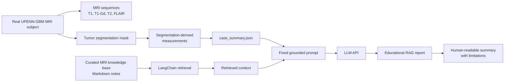
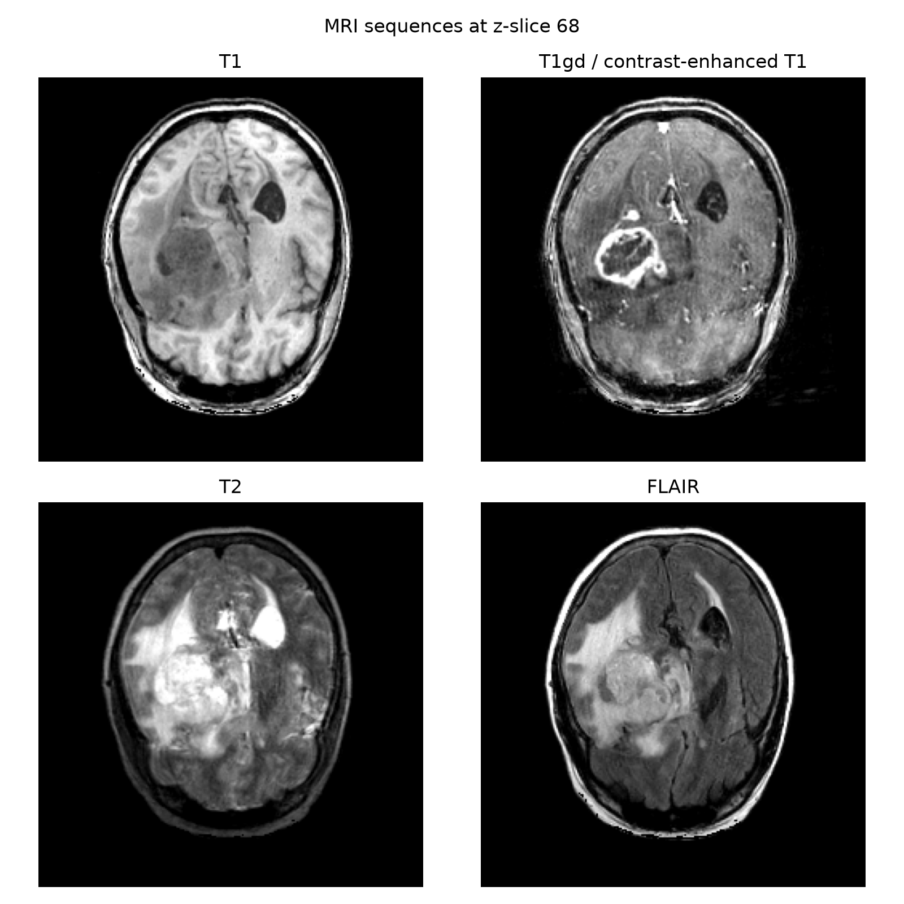
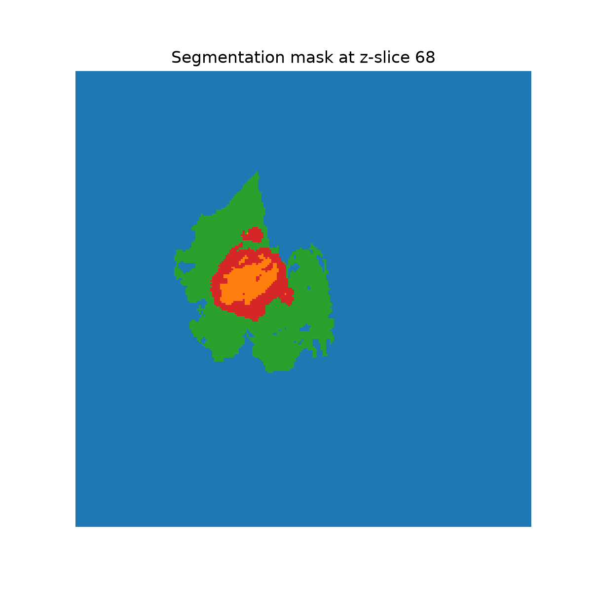
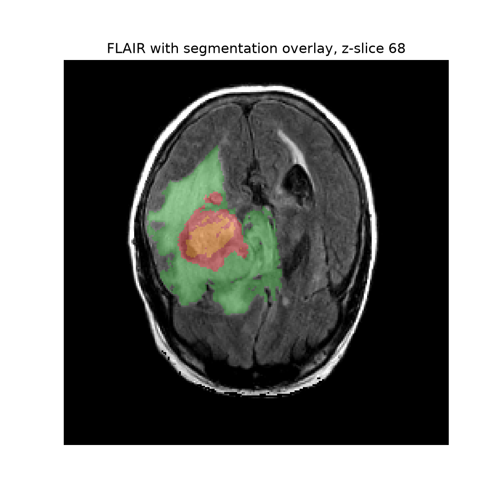
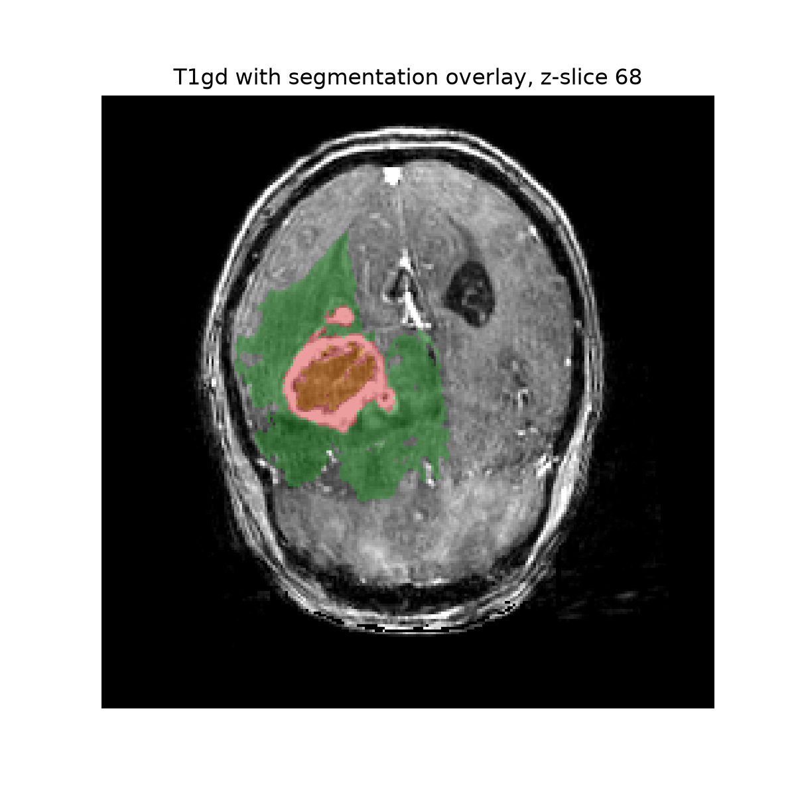

# Real-RAG-MRI: Retrieval-Augmented Reporting for Segmented Brain Tumor MRI


**Real-RAG-MRI** is a lightweight educational project that demonstrates how a real segmented brain MRI case can be converted into a structured, retrieval-grounded report.

The project uses one real subject from the **UPENN-GBM / TCIA GitHub release**, extracts tumor-region measurements from the provided segmentation mask, retrieves relevant MRI knowledge using LangChain, and generates a fixed RAG report with an OpenAI-compatible LLM API.

This is not a diagnostic system. It is a small, transparent prototype showing how medical imaging outputs can be transformed into explainable and auditable summaries.

---

## Project idea

Medical imaging AI does not stop at segmentation. A segmentation mask still has to be converted into information that a human can inspect and interpret:

* Which tumor regions are present?
* What is the volume of each segmented region?
* What do T1, T1-Gd, T2, and FLAIR mean?
* What does each segmentation label represent?
* What can and cannot be concluded from the measurements?
* Can the final report be grounded in trusted context instead of free-form generation?

This repository demonstrates that workflow end to end.

---

## Visual overview



---

## Example MRI data

The case contains four MRI sequences and one segmentation mask.

<p align="center">
  
</p>

The segmentation mask contains tumor-region labels.

<p align="center">
  
</p>

Segmentation overlay on FLAIR and contrast-enhanced T1:

<p align="center">
  
  
</p>

---

## What the files mean

For one subject, the pipeline downloads and standardizes these files:

| Local file              | Meaning                                                                    |
| ----------------------- | -------------------------------------------------------------------------- |
| `case_001_t1.nii.gz`    | T1-weighted MRI, useful for anatomical reference                           |
| `case_001_t1gd.nii.gz`  | Contrast-enhanced T1-weighted MRI, useful for enhancement-related context  |
| `case_001_t2.nii.gz`    | T2-weighted MRI, sensitive to fluid-rich tissue                            |
| `case_001_flair.nii.gz` | FLAIR MRI, useful for edema-like abnormal signal because CSF is suppressed |
| `case_001_seg.nii.gz`   | Tumor segmentation mask with integer region labels                         |
| `label_map.json`        | Maps segmentation label values to readable region names                    |

Current label map:

```json
{
    "0": "background",
    "1": "necrotic_tumor_core",
    "2": "peritumoral_edema",
    "3": "enhancing_tumor"
}
```

---

## Pipeline steps

### 1. Download one real MRI subject

```bash
python scripts/get_data.py
```

This downloads one subject, `sub-002`, from the UPENN-GBM TCIA GitHub release and saves it as:

```text
data/raw/upenn_gbm_subset/case_001/
```

The raw MRI files are not committed to GitHub.

---

### 2. Visualize MRI and segmentation

```bash
python scripts/explore_mri_images.py
```

This creates:

```text
outputs/case_001_mri_modalities.png
outputs/case_001_segmentation.png
outputs/case_001_flair_segmentation_overlay.png
outputs/case_001_t1gd_segmentation_overlay.png
```

---

### 3. Create segmentation-derived case summary

```bash
python scripts/01_create_case_summary.py
```

This creates:

```text
data/processed/case_001_summary.json
```

The summary includes:

* image shape
* voxel spacing
* label values found in the segmentation
* voxel count per tumor region
* volume per tumor region
* whole tumor volume
* tumor core volume

---

### 4. Create curated MRI knowledge base

```bash
python scripts/02_create_knowledge_base.py
```

This creates Markdown knowledge-base notes in:

```text
knowledge_base/curated_notes/
```

The notes explain:

* MRI sequences
* UPENN-GBM dataset structure
* tumor segmentation labels
* segmentation-derived measurements
* RAG reporting rules
* limitations and safety notes

---

### 5. Run LangChain retrieval

```bash
python scripts/03_langchain_retrieval_demo.py
```

This builds a Chroma vector database from the Markdown knowledge base using Hugging Face sentence-transformer embeddings.

It creates:

```text
outputs/case_001_retrieved_context.txt
```

---

### 6. Generate fixed RAG report

```bash
python scripts/04_fixed_rag_report.py
```

This combines:

```text
case_summary.json
+
retrieved_context.txt
+
fixed prompt
+
LLM API
```

and creates:

```text
outputs/case_001_llm_prompt.txt
outputs/case_001_fixed_rag_report.md
```

A sample generated report is included in:

```text
examples/case_001_fixed_rag_report.md
```

The exact prompt sent to the LLM is also saved for transparency:

```text
examples/case_001_llm_prompt.txt
```

---

## Repository structure

```text
real-rag-mri/
│
├── README.md
├── requirements.txt
├── .gitignore
├── .env.example
│
├── assets/
│   └── figures/
│       ├── case_001_mri_modalities.png
│       ├── case_001_segmentation.png
│       ├── case_001_flair_segmentation_overlay.png
│       └── case_001_t1gd_segmentation_overlay.png
│
├── data/
│   ├── raw/
│   ├── processed/
│   └── vector_db/
│
├── examples/
│   ├── case_001_fixed_rag_report.md
│   └── case_001_llm_prompt.txt
│
├── knowledge_base/
│   └── curated_notes/
│
├── outputs/
│
└── scripts/
    ├── get_data.py
    ├── explore_mri_images.py
    ├── 01_create_case_summary.py
    ├── 02_create_knowledge_base.py
    ├── 03_langchain_retrieval_demo.py
    └── 04_fixed_rag_report.py
```

---

## Installation

Create and activate a virtual environment:

```bash
python -m venv .venv
source .venv/bin/activate
```

Install dependencies:

```bash
pip install -r requirements.txt
```

---

## Environment variables

Create a `.env` file:

```bash
cp .env.example .env
```

Example `.env`:

```env
OPENAI_API_KEY=your_api_key_here
OPENAI_MODEL=gpt-4o-mini
```

For an OpenAI-compatible institutional endpoint, also add:

```env
OPENAI_BASE_URL=your_openai_compatible_endpoint
```

---

## Run the full pipeline

```bash
python scripts/get_data.py
python scripts/explore_mri_images.py
python scripts/01_create_case_summary.py
python scripts/02_create_knowledge_base.py
python scripts/03_langchain_retrieval_demo.py
python scripts/04_fixed_rag_report.py
```

---

## Example output

The final report is an educational technical summary. It includes:

* case overview
* available MRI sequences
* segmentation-derived tumor measurements
* explanation of tumor-region labels
* limitations of segmentation-derived measurements
* safety note
* grounding statement

The report is grounded in:

1. numeric values from `case_summary.json`
2. explanatory context retrieved from the knowledge base

The LLM is instructed not to invent clinical findings, diagnosis, prognosis, or treatment advice.

---

## What this project demonstrates

This repository demonstrates a practical medical imaging AI workflow:

```text
real MRI data
→ segmentation mask
→ quantitative feature extraction
→ structured case summary
→ retrieval over MRI knowledge base
→ fixed grounded LLM report
```

It shows skills in:

* medical image loading with NiBabel
* NIfTI handling
* segmentation-mask analysis
* tumor-region volume calculation
* MRI visualization
* LangChain retrieval
* Chroma vector stores
* Hugging Face embeddings
* OpenAI-compatible LLM APIs
* grounded report generation
* safety-aware medical AI prototyping

---

## What this project does not do

This repository does not:

* train a segmentation model
* fine-tune an LLM
* perform clinical diagnosis
* provide treatment recommendations
* validate segmentation correctness
* replace expert clinical review

The segmentation mask is provided by the dataset. The project focuses on converting segmentation outputs into structured, explainable, retrieval-grounded reports.

---

## Why this matters

Many medical AI systems produce outputs such as segmentation masks, probability maps, or measurements. These outputs are not always directly interpretable by end users.

This project explores how medical imaging outputs can be transformed into:

* structured measurements
* traceable summaries
* retrieved domain explanations
* safety-constrained reports

This is relevant for radiology AI, clinical trial imaging, tumor-burden quantification, dataset quality control, and human-in-the-loop medical AI workflows.

---

## Roadmap

Planned extensions:

* add spatial features such as centroid, bounding box, and slice range
* support multiple subjects instead of one subject
* add volume ratios such as edema-to-whole-tumor ratio
* replace or augment curated Markdown notes with retrieval from scientific papers
* add paper-based RAG using PDFs
* add a simple Streamlit interface
* add agentic RAG where the LLM chooses whether to retrieve, calculate, or summarize
* add stronger evaluation for faithfulness and hallucination control

---

## Safety statement

This project is for educational and research demonstration purposes only.

It is not a medical device, not a diagnostic tool, and not a substitute for expert clinical interpretation.

All generated reports should be treated as technical summaries of provided segmentation-derived measurements, not as clinical conclusions.
